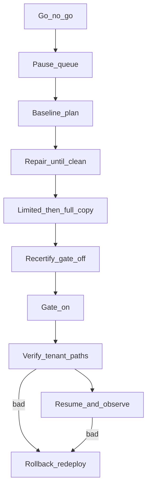

# Founder corpus production cutover (s1k.6.3)

> **Status: done.** Production was cut over on 2026-08-31 and
> `TENANT_DATA_PLANE = "1"` is pinned in `[env.production.vars]`. See
> "Production cutover — what actually happened" at the bottom for the record,
> the two tooling fixes it required, and what is still pending (legacy
> deletion). **Historical procedure, not a current operating checklist:** the
> one-time migration command and its dedicated code/tests are retired. The
> procedure below is preserved as executed evidence; do not repeat it for
> routine releases or staging deletion drills. The R2 manifests, list index and
> Vectorize namespaces it describes are legacy stores: reading state moved to
> PostgreSQL on 2026-09-24 ([ADR 0005](decisions/0005-postgresql-storage.md),
> [PostgreSQL cutover record](postgres-cutover.md)), and those stores, bare-id
> vectors included, were deleted on 2026-09-26 (reading-lite-gh351). Only the
> global-layout R2 objects remain pending deletion.

Operator runbook and human-approval checklist for copying the pre-tenant
production corpus into the founder tenant namespace and flipping
`TENANT_DATA_PLANE`. Staging rehearsed this on 2026-08-27 (`s1k.6.2`); this
document is the production procedure that rehearsal proved, including the
repairs and footguns it hit. Do not run production mutate commands until
Gate 1 is signed.

The [retirement note](operations.md#founder-corpus-migration-s1k6) describes the
current boundary. The [pre-retirement command](https://github.com/brian-bell/reading-lite/blob/b74a9b69af96b7101300d974e808e91ba34abdf9/scripts/ops-lib/commands/corpus-migrate-founder.ts)
and its tests remain in Git history. ADRs:
[0001 founder data cutover](decisions/0001-tenant-control-plane.md),
[0002 Vectorize namespaces](decisions/0002-vectorize-namespace-isolation.md).

## What this is

A **copy, never a move**. Every global-layout R2 object is copied
byte-identically to `u/{founderTenantId}/{same key}`. Every ready reading's
legacy Vectorize vector is re-read by id and re-upserted as
`{founderTenantId}:{readingId}` in the founder namespace with `tenant_id`
metadata. Stored `key_prefix` values stay relative, so object bodies do not
change. **Nothing is deleted** in this window — not global objects, not
bare-id vectors, not another tenant's leftover prefix.

The hosted Worker keeps serving the global layout until you set
`TENANT_DATA_PLANE=1`. After the flip it reads and writes the founder prefix
and namespaced vectors. Rollback is "unset the gate and redeploy"; legacy
state is still there.

Do **not** delete the global copies or bare-id vectors until after production
observation and explicit sign-off. That deletion is a later procedure, not
this one.



### In this window

- Pause production queue delivery
- Copy R2 objects into the founder prefix
- Re-upsert vectors from stored values. No paid re-embed
- Recertify with the gate still off
- Flip the gate with `wrangler deploy --env production --var TENANT_DATA_PLANE:1`
- Verify tenant paths
- Resume the queue
- Keep legacy data through the observation window

### Out of this window

- Pinning `TENANT_DATA_PLANE = "1"` in `wrangler.toml`
- Deleting global objects or bare-id vectors
- Account deletion (`s1k.10.1`)
- Any staging resource (`reading-lite-staging`, staging Worker, staging
  queue, staging founder id)
- Any merge to `main` during observation. CI would redeploy production
  without `--var` and roll the gate off

## Preconditions

All of these must already be true. None of them are this window's job.

1. Staging rehearsal finished: copy, `--limit` resume, full reconcile, gate
   on, tenant-path verification, gate off, legacy intact, queue resumed.
2. The migrate-founder tooling on this branch is **on `main` and deployed to
   the operator laptop** (R2 REST fallback, `foreign_tenant_object`
   informational, Vectorize `get_by_ids` chunk of 20, lag wait that ignores
   informational notes). Do not run production against an older command.
3. Production Worker already serves `tenantVectorId` compose/strip and
   `x-expected-tenant`. **Do not** ship that pin in the same deploy as the
   gate flip (ADR 0001 / operations.md). Confirm with a production
   `GET /api/whoami` that `tenant_data_plane` is still `false` before you
   start.
4. You can authenticate to production R2 + Vectorize (see Credentials) and
   you have the **production** founder bearer (`READER_API_TOKEN` from
   `.prd.vars`, not `.stg.vars`). `OPENAI_API_KEY` is only needed if a
   missing vector requires `corpus backfill-vectors`.
5. One state file, `./founder-migration.production.state.json` (gitignored).
   Same `--state` on every plan and execute. A file stamped for a different
   tenant, bucket, or index is refused.

## Do not

- Touch staging resources (`reading-lite-staging`, staging Worker, staging
  queue) as part of this window.
- Use the staging founder tenant id. Production's id comes from production
  `whoami`.
- Rely on the command default for `--bucket` as a safety rail. The default
  **is** production `reading-lite`. Always pass `--bucket` and `--vectorize`
  explicitly anyway, so a leftover staging habit cannot retarget you.
- Set `TENANT_DATA_PLANE = "1"` in `wrangler.toml` before the observation
  window. The flip is an ephemeral `--var` so an ordinary deploy rolls back.
- Use `npm run ops -- deploy worker` for the flip. That command cannot pass
  `--var`. Its default `--env` is **production**. A no-flag execute would
  deploy production **without** the gate — which is rollback, not cutover.
- Restore a missing vector with `POST /api/readings/:id/reprocess`. That is a
  paid summarization and can flip `source_type` (staging did this to
  `rd_8R39P3NZG5`). Use `corpus backfill-vectors` (Vectorize only; R2 stays
  read-only).
- `wrangler queues purge`, R2 deletes, Vectorize deletes, or
  `corpus drop` / `sweep` during this window.
- Leave queue delivery paused when you stop, abort, or finish.
- Leave `TENANT_DATA_PLANE=1` on if you are aborting.

## Credentials

From the environment or `.corpus.vars` (plan mode needs them too — it reads
live listings and vectors):

| Need | Names |
|---|---|
| Account | `CLOUDFLARE_ACCOUNT_ID` or `CORPUS_R2_ACCOUNT_ID` |
| R2 + Vectorize | `CLOUDFLARE_API_TOKEN` or `CORPUS_CF_API_TOKEN`, **or** S3 `CORPUS_R2_ACCESS_KEY` + `CORPUS_R2_SECRET_KEY` |
| Missing-vector repair only | `OPENAI_API_KEY` (text-embedding-3-small). migrate-founder itself does not embed. |
| API checks | production `READER_API_TOKEN` |

Cloudflare's edge often 403s Python `urllib` against the Worker. Use
`curl -A curl/8` for `/api/*`. The Cloudflare REST APIs (R2, Vectorize) are
fine from Node/`npx tsx`.

## Constants (fill these in, then paste)

```sh
# Production founder tenant: GET /api/whoami with the production bearer.
# Do not copy the staging id.
TENANT=usr_…                                          # from whoami.tenant_id
BUCKET=reading-lite
INDEX=reading-lite
QUEUE=reading-lite
BASE=https://reading-lite.bbell.dev
STATE=./founder-migration.production.state.json       # gitignored (*.state.json)
AUTH="Authorization: Bearer $READER_API_TOKEN"

# Every migrate-founder / rebuild-list / backfill-vectors invocation:
MIGRATE=(--tenant "$TENANT" --bucket "$BUCKET" --vectorize "$INDEX" --state "$STATE")
```

Pass the **same** `--state` to every plan and execute. Plan reads the etag
cache and never writes the file; execute writes the copy/vector ledger.
A state file stamped for a different tenant, bucket, or index is refused.

## HITL gates

Acceptance is three human stops. Sign and date each before the named phase.

### Gate 1 — Start the window

Required before Phase 1. Queue pause is the first mutating command.

- [ ] Preconditions above are all checked
- [ ] `whoami` is `tenant_data_plane: false` and `$TENANT` is the production founder
- [ ] Operator laptop is on `main` with the rehearsed migrate-founder tooling

**Signed:** ________  **Date:** ________

### Gate 2 — Flip the gate

Required before Phase 6.

- [ ] Phase 5 printed `Fully migrated`
- [ ] Global object count is unchanged from Phase 2
- [ ] Founder dest count matches copies plus any pre-existing founder-prefix leftovers
- [ ] One ready id exists as both the bare vector and `$TENANT:rd_…` with matching namespace and `metadata.tenant_id`

**Signed:** ________  **Date:** ________

### Gate 3 — Keep or roll back

Required before Phase 8 resume, or Phase R rollback.

- [ ] Phase 7 list count equals certified `list_rows`
- [ ] Detail, content, lookup, `q=`, and similar look right. Similar returns bare ids and founder-only neighbors
- [ ] Decision: keep the gate on and resume, or roll back

**Signed:** ________  **Date:** ________  **Keep / rollback:** ________

---

## Phase 0 — Confirm target and gate

```sh
curl -sS -A curl/8 -H "$AUTH" "$BASE/api/whoami"
# Expect: tenant_data_plane false, tenant_id == $TENANT (production founder)

npx wrangler whoami
# Expect the account that owns bucket/index reading-lite
```

Record `$TENANT`. If `tenant_data_plane` is already `true`, stop — this
runbook assumes a gate-off start.

## Phase 1 — Freeze the realtime writer

**Gate 1 must be signed.**

Pause **delivery** so the consumer stops paid work. Submits can still write a
pending manifest and enqueue; this window is a maintenance hold: no
submit / import / reprocess / recover / ingest from you or the SPA.

```sh
npx wrangler queues pause-delivery "$QUEUE"
```

`--sole-writer` is an operator assertion, not a lock. The command will not
check that the queue is paused.

Drain:

1. Wait until in-flight consumer invocations finish (pause does not kill the
   current message).
2. `GET $BASE/api/readings?limit=100` and page `has_more`. Note any
   `pending` rows. They copy as pending; they will not process until you
   resume. Prefer zero pending before execute.
3. Do **not** purge the queue.

Abort now: `npx wrangler queues resume-delivery "$QUEUE"`. Nothing else to
undo.

## Phase 2 — Baseline

Take a plan (writes nothing) and keep the JSON.

```sh
npm run ops -- corpus migrate-founder "${MIGRATE[@]}" \
  > /tmp/founder-prod-plan0.json
```

From stderr, record:

- source object count (`global` layout — keys not under `u/`)
- list rows and ready rows
- pending copies / pending vectors
- every `! kind:` line

From stdout `counts` plus a listing of keys under `u/`, record:

- objects already under `u/$TENANT/` (leftover from earlier tests; execute
  overwrites destination mismatches with source bytes)
- objects under any other `u/usr_…/` prefix (`foreign_tenant_object` —
  informational; do not delete them)

Optional ADR 0001 extras (this cutover does not mutate D1):

```sh
npx wrangler vectorize info "$INDEX"
# wrangler d1 time-travel: bookmark/timestamp if you want a control-plane
# restore point. Not required to copy R2/Vectorize.
```

`GET $BASE/api/readings?limit=100` row count should match `counts.list_rows`.

## Phase 3 — Repair until execute is allowed

Re-plan after every repair. Execute aborts before any write when
`executeBlockingProblems` is non-empty.

### Problem classes

| Kind | Class | Repair |
|---|---|---|
| `foreign_tenant_object` | Informational | Leave it. Does not block execute or "fully migrated". |
| `destination_mismatch` | Handled by execute | Execute overwrites dest with source bytes. Common when a leftover founder `index/list.json` already exists. |
| `unrecognized_key` | Copied, blocks certification until dispositioned | Still copied (zero-loss). Investigate what the key is before calling the corpus fully migrated. |
| `row_manifest_mismatch` | Blocks execute | Stale `index/list.json` (staging: missing `keywords`; one row said `pending` while the manifest was `ready`). Rebuild the list. |
| `row_by_id_pointer_invalid`, `row_missing_*`, `by_url_pointer_invalid`, `manifest_not_in_list_index`, `invalid_list_index`, `missing_list_index` | Blocks execute | Repair the named object / pointer; then rebuild-list if the row is stale. |
| `missing_legacy_vector` | Blocks execute | Ready row with no bare-id vector. Backfill. Staging had exactly one (`rd_8R39P3NZG5`). |
| `unverified_tenant_vector` | Blocks certification | Prefixed vector missing, wrong namespace, missing `tenant_id` stamp, or values/metadata do not match legacy. Re-execute after the cause is fixed; wait for Vectorize lag. |

### Stale list rows

These repairs must target the pre-tenant **source** layout (`--tenant global`),
not the founder destination. migrate-founder copies from global into
`u/{$TENANT}/`.

```sh
npm run ops -- corpus rebuild-list --tenant global --bucket "$BUCKET"
npm run ops -- corpus rebuild-list --tenant global --bucket "$BUCKET" \
  --execute --sole-writer
```

Rebuild-list is a plain put of `index/list.json`. Requires `--sole-writer`.
Then re-plan migrate-founder.

### Missing legacy vectors

Same source-layout rule: restore the **bare-id** vector that migrate-founder
will re-upsert into the founder namespace. `--tenant "$TENANT"` would miss it.

```sh
npm run ops -- corpus backfill-vectors --tenant global --bucket "$BUCKET" \
  --vectorize "$INDEX" rd_…
npm run ops -- corpus backfill-vectors --tenant global --bucket "$BUCKET" \
  --vectorize "$INDEX" rd_… --execute
```

Needs `OPENAI_API_KEY` in this shell. Upserts are asynchronous; wait ~10s and
re-plan. Do **not** substitute Worker reprocess.

When the plan shows no execute-blocking kinds (informational foreign-tenant
notes and/or destination mismatches are fine), go to Phase 4.

## Phase 4 — Interrupted resume, then full copy

First pass, small, to prove the state file resumes:

```sh
npm run ops -- corpus migrate-founder "${MIGRATE[@]}" \
  --execute --sole-writer --limit 20
```

Expect: some copies, maybe some vectors, exit 1 if work remains, ledger
entries in `$STATE`. Re-plan without `--execute` must show `copied` increased
and pending decreased.

Full resume (same `--state`, no `--limit`):

```sh
npm run ops -- corpus migrate-founder "${MIGRATE[@]}" \
  --execute --sole-writer
```

Stderr should include `Copied N objects, migrated M vectors this pass` and
may wait once or twice (`N vector(s) not yet visible — Vectorize mutations
are asynchronous`). Success is:

```
Fully migrated: reconciliation holds; safe to proceed with the gate-flip prerequisites.
```

stdout carries `fully_migrated: true` and `reconciled_at`. Keep that JSON.

If the process dies mid-copy: rerun the same execute command. It skips
objects already in the ledger at the live dest etag. Do not start a second
state file.

## Phase 5 — Recertify (gate still off)

```sh
npm run ops -- corpus migrate-founder "${MIGRATE[@]}" \
  > /tmp/founder-prod-plan-certified.json
```

Must print `Fully migrated` even with `foreign_tenant_object` notes.
Evidence line should be mostly cache hits (`0 object reads, C served from
the state file's etag cache`) if `$STATE` is the same file.

Spot-check (copy, not move):

- Global object count from Phase 2 is unchanged (lost 0).
- Founder dest count = global copies + any pre-existing founder-prefix
  objects that were not overwritten.
- Other `u/usr_…/` prefixes unchanged.
- One ready id resolves both as the bare Vectorize id **and** as
  `$TENANT:rd_…` with `namespace` and `metadata.tenant_id` equal to `$TENANT`.

List/detail/search still hit the **global** layout (`tenant_data_plane`
false). After the copy, an unnamespaced `POST /api/readings/similar` can
return **both** the bare id and the prefixed id for the same reading. That
is expected until the gate flips (namespaced query) or until post-observation
deletion. Keyword `q=` search is unaffected.

Do not flip the gate until this phase is clean.

**Gate 2 must be signed before Phase 6.**

## Phase 6 — Gate on

Dry-run first; bindings must still name production queue, D1, Vectorize, and
bucket `reading-lite`, plus `env.TENANT_DATA_PLANE ("(hidden)")` alongside
the existing `[env.production.vars]`.

```sh
npx wrangler deploy --env production --var TENANT_DATA_PLANE:1 --dry-run
npx wrangler deploy --env production --var TENANT_DATA_PLANE:1
```

Record `Current Version ID`. This is the only command that turns the gate
on. `ops deploy worker` cannot.

## Phase 7 — Verify tenant paths

```sh
curl -sS -A curl/8 -H "$AUTH" "$BASE/api/whoami"
# tenant_data_plane: true, tenant_id: $TENANT

curl -sS -A curl/8 -H "$AUTH" "$BASE/api/readings?limit=100"
# row count == certified list_rows, not a leftover 2-row founder list
```

Then, for at least one ready reading with captured content and at least one
failed row:

- `GET /api/readings/:id` — title, status, connections
- `GET /api/readings/:id/content` — 200 and a real body
- `GET /api/readings/lookup?url=…` — the owned id
- `GET /api/readings?q=…` — keyword hits from the copied list
- `POST /api/readings/similar` with a namespaced vector's values — **bare**
  reading ids (the store strips `$TENANT:`), self-match near 1.0, neighbours
  from the founder corpus only

If list row count collapses to a leftover founder `index/list.json` from
before the copy, stop and roll back (Phase R). That means the dest list was
not overwritten; re-plan should have shown `destination_mismatch` until
execute.

**Gate 3 must be signed before Phase 8 or Phase R.**

## Phase 8 — Observation (gate on, legacy retained)

Resume the queue only after Phase 7 looks right:

```sh
npx wrangler queues resume-delivery "$QUEUE"
```

Leave global R2 objects and bare-id vectors in place. New writes now land
under `u/$TENANT/` and as `{tenantId}:{readingId}` vectors.

Until you pin the gate in `wrangler.toml`, **any** later
`wrangler deploy --env production` or `ops deploy worker --env production
--execute` rolls the gate **off**. That includes a merge to `main`, which
runs `.github/workflows/deploy-worker.yml`. Do not deploy production for
other reasons during this window.

Watch for: list/detail/content, submit/reprocess of a throwaway URL (lands
in the tenant prefix), similarity returning bare ids, no 412 storms on
`x-expected-tenant`.

## Phase R — Rollback

Use this after a bad Phase 6/7, or if observation fails. Legacy data must
still exist (it should: this procedure never deletes it).

```sh
npx wrangler deploy --env production
# no --var. NOTE: both deployed environments now pin TENANT_DATA_PLANE = "1"
# in their own [vars] — production since this cutover, staging since the
# deletion staging gate (issue #203). Rolling the gate off is therefore a
# wrangler.toml edit plus a deploy, not a bare deploy; removing the pin also
# means relaxing the assertion in
# test/unit/deploy/account-wipe-wrangler.test.ts in the same commit.
```

Record the new version id. Confirm:

```sh
curl -sS -A curl/8 -H "$AUTH" "$BASE/api/whoami"
# tenant_data_plane: false

curl -sS -A curl/8 -H "$AUTH" "$BASE/api/readings?limit=100"
# global list row count from Phase 2
```

Integrity: global objects still present, founder copies still present, other
tenant prefixes untouched, bare-id vectors still resolvable.

`POST /api/readings/similar` will again see **both** copies (prefixed +
bare). List/detail rollback is the global layout; that duplicate-id similar
response is not a rollback failure.

Then:

```sh
npx wrangler queues resume-delivery "$QUEUE"
```

Copy artifacts under `u/$TENANT/` can stay. The next production attempt
resumes from `$STATE` if tenant/bucket/index still match.

## Abort before the flip

If you never ran Phase 6:

```sh
npx wrangler queues resume-delivery "$QUEUE"
```

Gate stays off. Partial or full copies under `u/$TENANT/` are leftover
objects, same as staging's pre-existing founder prefix. They are not
production reads while the gate is off.

## Record sheet

| Field | Value |
|---|---|
| Date | |
| Operator | |
| `$TENANT` | |
| Phase 2 global objects | |
| Phase 2 list rows / ready rows | |
| Phase 2 pending copies / vectors | |
| Phase 2 leftover founder-prefix objects | |
| Phase 2 foreign `u/usr_…/` prefixes | |
| Phase 2 `! kind:` lines | |
| Phase 5 certified global objects | |
| Phase 5 founder dest count | |
| `fully_migrated` timestamp | |
| Gate-on Worker version id | |
| Rollback Worker version id (if used) | |
| Observation notes | |

## Acceptance mapping

| Criterion | Evidence on this page |
|---|---|
| Human approves the maintenance and rollback checkpoints before execution | Gates 1–3 signed and dated |
| Production pre/post inventories reconcile with zero lost readings or broken connections | Phase 2 vs Phase 5 counts, plus Phase 7 lookups and connections on a ready row |
| Tenant mode is activated only after checks pass, and legacy data remains available through the approved rollback window | Gate 2 before Phase 6. No deletes. Phase R still possible until later sign-off |

## After sign-off (not this window)

Only after observation looks clean:

1. Pin `TENANT_DATA_PLANE = "1"` under `[env.production.vars]` in
   `wrangler.toml` so ordinary deploys keep the gate on. **Done 2026-08-31.**
2. `npm run ops -- deploy worker --env production --execute` (now the pin is
   in toml). **Done 2026-08-31** via the merge-to-main deploy of the pin.
3. A **separate** signed-off procedure deletes global-layout objects and
   bare-id vectors. Do not invent that deletion here. **Still pending.**

Staging `wrangler.toml` stays unset unless you deliberately cut staging over
too.

---

## Staging rehearsal — what actually happened

Environment: Worker `https://reading-lite-staging.bellbm.workers.dev`,
bucket/index `reading-lite-staging`, founder
`usr_24b3629b-a738-440a-9122-99ee70e04aa1`. Queue paused, then resumed.

| Step | Result |
|---|---|
| Baseline | 190 global objects, 35 list rows; 10 isolation-test objects under `u/usr_11111111-…/`; 10 leftover founder-prefix objects |
| First plan | Blocked on `row_manifest_mismatch` (stale `index/list.json`, mostly missing `keywords`; one row `pending` vs manifest `ready`) |
| `rebuild-list --tenant global` | 35/35 rows, 21 keyword backfills |
| Second plan | Blocked on `missing_legacy_vector` for `rd_8R39P3NZG5` |
| Vector restore | Worker reprocess (no local `OPENAI_API_KEY`); **rewrote** that manifest / `source_type`. Production must use `backfill-vectors` instead. Vectorize `get_by_ids` lagged ~10s; index count 27→28 |
| `--execute --limit 8` | 8 copies, 8 vectors, resumable ledger |
| Full resume | 187 more copies, 18 vectors; one Vectorize lag wait; **fully migrated** at 2026-08-27T04:58:36Z. Ledger: 195 copies, 26 vectors |
| Integrity | global 195 (lost 0); founder dest 204; isolation-test 10; dest `list.json` matched source |
| Gate on | `wrangler deploy --env staging --var TENANT_DATA_PLANE:1` version `1d0bcdd2-…`. whoami true. 35 rows. Detail/content/lookup/`q`/similar (bare ids) OK |
| Gate off | `wrangler deploy --env staging` version `73ca3a4d-…`. whoami false. 195/204/10 still present. Similar returned prefixed **and** bare ids |
| Queue | `resume-delivery reading-lite-staging` |

Tooling the rehearsal required, which production must have:

- R2 REST when S3 keys are absent (`CLOUDFLARE_API_TOKEN`)
- `foreign_tenant_object` does not block execute or certification
- Vectorize `get_by_ids` in chunks of 20 (50 trips API `40007`)
- Lag wait uses `certificationProblems` so foreign-tenant notes do not skip it

## Command cheat sheet

```sh
# plan / recertify
npm run ops -- corpus migrate-founder "${MIGRATE[@]}"

# resume-safe copy
npm run ops -- corpus migrate-founder "${MIGRATE[@]}" --execute --sole-writer [--limit N]

# freeze / unfreeze paid work
npx wrangler queues pause-delivery reading-lite
npx wrangler queues resume-delivery reading-lite

# flip / unflip (production Worker). Not ops deploy worker.
npx wrangler deploy --env production --var TENANT_DATA_PLANE:1
npx wrangler deploy --env production
```

---

## Production cutover — what actually happened (2026-08-30/31)

Environment: Worker `reading-lite` at `https://reading-lite.bbell.dev`,
bucket/index `reading-lite`, founder
`usr_1700450b-c2df-4421-8805-c308a63b4dea`. Operator laptop on `main`.
Queue paused 2026-08-31 ~00:10Z, resumed ~02:10Z.

| Step | Result |
|---|---|
| Credentials | `.corpus.vars` S3 keys were staging-bucket scoped (403 on `reading-lite`); the Cloudflare API token had Vectorize but not R2. Ran with S3 keys minted for bucket `reading-lite` (sourced from a file outside the repo) plus `CORPUS_CF_API_TOKEN` for Vectorize. |
| First plans | Aborted on a Vectorize `get_by_ids` 429 (`code 971`); once past that, ~780 R2 REST 429s were reported as `by_url_pointer_invalid` / `row_by_id_pointer_invalid` / `row_manifest_unreadable`. Fixed by PR #210 (429 backoff in the scripts' R2 REST + Vectorize clients). Over S3 the plan takes ~45s; over REST it crawls under the ~1200 req/5 min API limit. |
| Baseline | 3634 global objects, 558 rows (545 ready / 13 failed / 0 pending), 548 vectors, 0 objects under `u/`. Real problems: 436 rows missing `similarity` (stale list), 6 rows with no by-url pointer (2026-05-02 readings), 11 manifests with no list row (1 ready `rd_H5EY0E0MNA`, 9 stale pendings, 1 failed). |
| Repairs | Wrote the 6 `{id,key_prefix}` pointers with putIfAbsent; deleted all 11 orphans (34 objects, 2 owned by-url pointers, 1 vector — the ready one by explicit decision, since `corpus drop` refuses ready ids in production); `rebuild-list --execute --sole-writer`. |
| Rebuild-list footgun | The first rebuild wrote three titles' em/en dashes as U+FFFD: the wrangler child-process runner decoded stdout per chunk. Fixed by PR #211; rebuilt again; plan clean (0 problems). |
| `--execute --limit 20` | 20 copies, 20 vectors; re-plan served 1674 verifications from the etag cache and showed `20 copied`. |
| Full resume | 3586 copies, 525 vectors, one Vectorize lag wait (195 vectors); **fully migrated** ~01:36Z. Ledger 3606 copies / 545 vectors. |
| Integrity | global 3606 (lost 0); founder dest 3606; other tenant prefixes 0; founder `index/list.json` byte-identical to global (718 293 B, 558 rows). `rd_WXF4309PBA` present as bare (`namespace=null`) and as `usr_…:rd_WXF4309PBA` (`namespace` + `metadata.tenant_id` = founder) with identical values. Index count 1092. |
| Gate on | `wrangler deploy --env production --var TENANT_DATA_PLANE:1` version `6b0d07b7-8c5b-4716-aa19-dc84318d4ba9`. whoami true; 558 rows; detail/content/lookup/failed-row/`q=` OK; `POST /similar` returned bare ids, self 1.0, founder-only neighbours. |
| Observation | First post-cutover submit `rd_E1PVN0RMBG` landed entirely under `u/{founder}/` (objects, by-id, by-url, list row 559) with nothing in the global layout; its vector is in the founder namespace. Gate then pinned in `wrangler.toml`. |

Quirks worth knowing:

- Vectorize `get_by_ids` on **prefixed** ids intermittently returns `[]` even
  when a namespaced `query` finds the same vectors at 1.0. The Worker only
  queries; migrate-founder's certification read them fine. Don't treat an
  empty `get_by_ids` alone as vector loss.
- `wrangler vectorize info` fails under the OAuth login on this account; the
  REST `…/indexes/reading-lite/info` call with the API token works.

Still pending: the separate, signed-off deletion of global-layout objects and
bare-id vectors (3606 objects, 547 vectors). (Update, 2026-09-26: the vectors
went with the Vectorize index in reading-lite-gh351.6; the global objects
remain.) Until then `--tenant global` addresses that retained R2 copy; the
commands that read or delete reading rows refuse it. Live production corpus
ops use `--tenant "$TENANT"` from whoami (see `docs/operations.md`), not
`global`.

